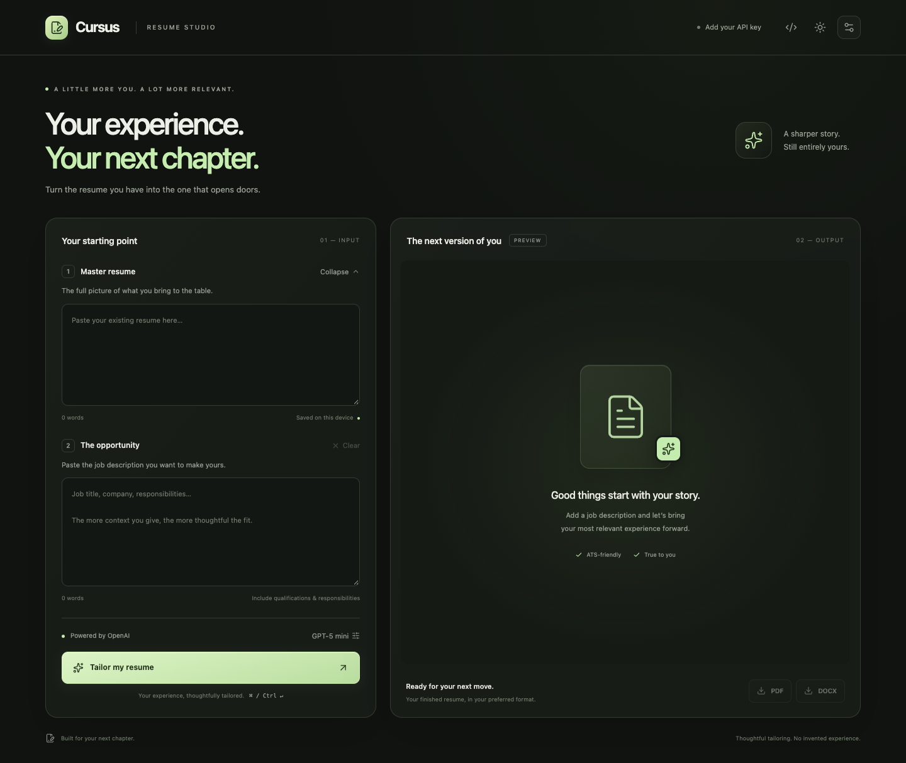

<div align="center">

[](https://cursus-resume-studio.vercel.app/)


# Cursus



### Your experience. Your next chapter.

Cursus turns an existing resume and a job description into a focused draft you can review and export. It helps bring relevant experience forward without asking the model to invent qualifications.

**[Try the live demo →](https://cursus-resume-studio.vercel.app/)** · [Run it locally](#quick-start)

</div>

## Why Cursus?

Rewriting a resume for every application takes time, and it is easy to lose the details that make your experience yours. Cursus gives you a simple workspace to compare your background with a role and shape a clearer first draft.

- Paste your master resume and the job description
- Generate a structured resume with the OpenAI Responses API
- Preview the result and export it as PDF or DOCX
- Keep drafts, model choice, and appearance in your browser
- Switch between light and dark themes on desktop or mobile
- See when a preview belongs to older inputs after an edit or failed retry

## Quick start

You need Node.js **20 or newer**, npm, and an [OpenAI API key](https://platform.openai.com/api-keys).

```bash
git clone https://github.com/ztxv/cursus-resume-studio.git
cd cursus-resume-studio
npm install
npm start
```

Open [http://localhost:3000](http://localhost:3000). In **Settings**, save your key and choose GPT-5 mini, GPT-5, or a custom GPT model ID available to your API project. Paste your resume and a job description, then select **Tailor my resume**. You can also use **Cmd/Ctrl + Enter**.

> [!IMPORTANT]
> Cursus starts with an empty resume field. Your master resume and API key are not included in this repository. The key and drafts are saved unencrypted in this browser's local storage, so use a trusted device. OpenAI API usage may incur charges.

## How it works

```text
Master resume + job description
              ↓
       Local Express API
              ↓
      OpenAI Responses API
              ↓
    Validated resume data
              ↓
    Preview + PDF / DOCX
```

The server requests a strict JSON shape, validates the response, and builds the preview. It creates PDF files with Puppeteer and Word files with `docx`. The prompt tells the model to preserve your facts and use only supported job keywords. **Review every generated line before sending it**; AI output can still be wrong.

## Features

### Tailoring workspace

- Browser-saved resume and job description drafts
- GPT-5 mini, GPT-5, and custom GPT model ID selection
- Word counts, keyboard shortcut, and responsive layout
- Clear status when a previous result no longer matches the inputs

### Document output

- Live resume preview
- PDF export in US Letter format
- Editable DOCX export
- Export buttons remain available for the last successful result after a failed retry

## Technology

| Layer | Technology |
| --- | --- |
| Server | Node.js, Express |
| AI | OpenAI Responses API with strict structured output |
| Interface | HTML, CSS, JavaScript, Shoelace, Lucide, Motion |
| Exports | Puppeteer, `docx` |
| Tests | Node.js built-in test runner |

Interface dependencies are served from installed packages. PDF export uses Chrome or Chromium on the machine, including Puppeteer's installed browser when available.

## Commands

```bash
npm start        # Run on localhost:3000
npm run dev      # Run with automatic server restarts
npm test         # Run the automated tests
PORT=3001 npm start  # Use another port
```

Tests mock OpenAI requests; they do not need an API key or incur usage.

## Hosted demo

**Live at [cursus-resume-studio.vercel.app](https://cursus-resume-studio.vercel.app/).** Click around freely: it is a demo, so nothing is generated, saved, or sent. To get the real app, [run it locally](#quick-start).

The same interface can be built as a static, server-free demo for hosts like Vercel. It loads a fictional sample resume and job posting, "tailors" it to a pre-written sample result, and turns PDF/DOCX export off. No AI is called, no key is needed, and nothing is saved or sent.

```bash
npm run build:demo   # static site in demo-dist/
npm run dev:demo     # build and preview at http://localhost:3100
```

To deploy on Vercel, import the repository and keep the defaults; `vercel.json` sets the install command (skipping Puppeteer's Chromium download), build command, and output directory. The demo build serves the real `public/` files and the real resume template unchanged, and ships none of the server code. `npm start` remains the real app.

## Project structure

```text
assets/           README screenshot
demo/             Hosted-demo only: sample data, in-browser API shim, banner styles
lib/openai.js     OpenAI request, schema, and response validation
lib/resume-html.js  Resume preview and PDF template (shared with the demo)
public/           Interface, styles, and browser behavior
scripts/          Static demo build
server.js         Local API and document exports
test/             API, export, demo, and interface-state tests
```

## Privacy and security

- Your API key, resume draft, and job description live in browser `localStorage`, unencrypted.
- When you generate a draft, the browser sends the key to the local server, which forwards it to OpenAI. The server does not persist the key or drafts to disk.
- OpenAI generation requests use `store: false`.
- The server binds to `127.0.0.1` for personal use on your computer. Public hosting would require authentication and a security review.
- `.env` files, generated output, and common resume document formats are ignored by Git. Review `git status` before publishing changes.

## Current limitations

- No cloud sync or accounts; drafts stay in the current browser.
- A valid OpenAI API key is required to generate a resume.
- Generated results are not restored after a page reload; export them before leaving.
- AI may omit or misstate details, so the final document needs your review.

## Contributing

Focused improvements are welcome. Fork the repository, make your change, run `npm test`, and open a pull request explaining what changed.

---

<div align="center">

**Cursus v1.0.0** · Built by [ztxv](https://github.com/ztxv)

</div>
